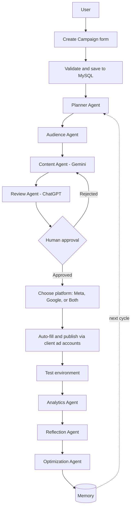

# Prachaar---The-Multi-Agent-Platform
Prachaar is a multi-agent AI platform that plans, runs, and improves ad campaigns in a loop. Agents plan, write, review, publish to Meta and Google Ads after human approval, then learn from results to do better each cycle.
# Prachaar

**Plan. Act. Measure. Reflect. Improve.**

Prachaar is a multi-agent AI platform that plans, runs, and improves marketing campaigns in a continuous loop. A user fills in a simple campaign brief, and a team of specialized AI agents creates the plan, audience personas, and ad copy. A second AI model reviews the copy, and a human approves it before anything goes live. The campaign is then published to Meta Ads and/or Google Ads using the client's own ad accounts and wallets, so Prachaar never holds ad money. After the results come in, analytics, reflection, and optimization agents save lessons to memory, and the next cycle starts smarter than the last.

## Demo

[Live interactive simulation](https://claude.ai/artifact/RtmNWetJAaJS9nQGjuzaKg)

## Screenshots

| Dashboard | Create Campaign |
|---|---|
|  |  |

| Agents at work | Review and approval |
|---|---|
|  |  |

| Platform selection | Live metrics and cycles |
|---|---|
|  |  |

## Architecture

## How it works

1. **Brief:** The user enters goal, product, audience, budget, and platform. The data is validated and stored in MySQL.
2. **Plan:** Planner, Audience, and Content agents (Gemini) produce a campaign plan, personas, and ad copy.
3. **Review:** A Review Agent (ChatGPT) scores the copy and improves it. Two different models cross-check each other.
4. **Approve:** The user must approve the final ad. Nothing is published without this step.
5. **Publish:** The user picks Meta Ads, Google Ads, or both. Prachaar fills in each platform's forms and publishes at the same time. Spend is charged to the client's own ad accounts.
6. **Measure:** Clicks, CTR, and conversions are tracked per platform, starting in a safe test environment.
7. **Reflect and improve:** Analytics, Reflection ("what worked, what failed, why"), and Optimization agents save lessons to Memory.
8. **Repeat:** The next cycle begins with those lessons, so results improve over time.

## Agents

| Agent | Role | Model |
|---|---|---|
| Planner | Builds the campaign plan | Gemini |
| Audience | Creates audience personas | Gemini |
| Content | Writes ad copy | Gemini |
| Review | Scores and improves copy | ChatGPT |
| Analytics | Charts campaign results | TBD |
| Reflection | Explains what worked, failed, and why | TBD |
| Optimization | Suggests improvements and writes to Memory | TBD |

## Safety and trust

- **Human in the loop:** Every campaign needs explicit approval.
- **No custody of ad money:** Budgets are spent from the client's own Meta and Google Ads wallets.
- **Test environment first:** Campaigns run in a safe environment before real spend.

## Tech stack

- Frontend: WordPress-style dashboard
- Database: MySQL
- AI: Gemini (planning and content), ChatGPT (review)
- Ad platforms: Meta Ads, Google Ads

## Roadmap

- [ ] Connect real Meta Ads and Google Ads accounts
- [ ] Multi-client support
- [ ] A/B testing across cycles
- [ ] Performance comparison against a no-learning baseline

## License

MIT
